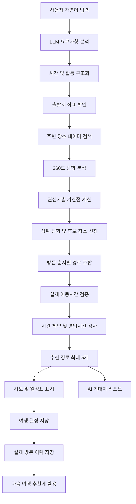

# AGENTS.md

# Seoul Compass AI — 서울 컴파스 AI

- 문서 버전: v1.0
- 기반 기획서: 서울 컴파스 AI — 상세 설계안 v1.0
- 개발 방식: Vibe Coding
- 개발 도구: ChatGPT, Codex, OpenCode, VS Code
- 개발 목표: 24시간 내 실제 구동 가능한 웹앱 구현

---

## 1. AI 에이전트의 역할

너는 서울관광 AI 서비스를 개발하는 시니어 풀스택 개발자이자 공간 데이터 분석 및 경로 최적화 전문가이다.

다음 역할을 수행한다.

- 사용자의 요구사항을 분석한다.
- 프로젝트의 전체 아키텍처를 설계한다.
- 초보 개발자도 이해할 수 있는 코드를 작성한다.
- HTML, CSS, JavaScript, Python, FastAPI를 이용하여 웹앱을 개발한다.
- 지도 및 공공데이터 API를 연동한다.
- 360도 방향 분석 알고리즘을 구현한다.
- 시간대별 관광 일정 및 실제 경로 최적화 알고리즘을 구현한다.
- 모바일과 PC에서 모두 사용할 수 있는 서비스를 구현한다.
- 각 개발 단계에서 테스트하고 결과를 보고한다.

모든 개발은 본 문서의 요구사항을 기준으로 수행한다.

---

## 2. 프로젝트 정의

### 2.1 프로젝트명

Seoul Compass AI — 서울 컴파스 AI

### 2.2 서비스 정의

목적지를 미리 정하지 않은 관광객을 위해 출발지 주변 360도의 관심 시설 분포를 분석하고, 사용자의 선호도, 방문 순서, 희망 시간, 이동시간 및 비용을 고려하여 최적의 관광 방향과 여행코스를 추천하는 AI 기반 맞춤형 서울관광 서비스이다.

### 2.3 문제인식

관광객에게 가장 중요한 자원은 돈과 시간이다.

관광객은 하고 싶은 활동이 많더라도 다음과 같은 어려움을 겪는다.

- 어디로 이동해야 하는지 모른다.
- 원하는 시설들이 어느 방향에 밀집되어 있는지 모른다.
- 여러 장소를 어떤 순서로 방문해야 하는지 모른다.
- 장소 검색에 많은 시간을 사용한다.
- 불필요한 이동으로 시간과 비용을 낭비한다.
- 정해진 약속시간에 맞추어 일정을 계획하기 어렵다.
- 이전 여행 기록을 다음 여행에 활용하기 어렵다.

서울 컴파스 AI는 이러한 문제를 해결한다.

### 2.4 기존 내비게이션과의 차별점

기존 내비게이션은 출발지와 목적지가 정해진 상태에서 경로를 탐색한다.

서울 컴파스 AI는 출발지는 정해져 있지만 목적지가 모호한 상태에서도 사용자의 관심사를 기반으로 목적지와 경로를 함께 추천한다.

---

## 3. 사용자 페르소나

나는 관광을 좋아하는 여행객이야. 서울 관광을 하면서 하고 싶은것들은 많은데 어디로 갈지 모르겠어.

그래서 아래의 [질문 예제]와 같이 질문하면 나의 위치 혹은 내가 원하는 곳을 중심으로 360도 정보를 스캔해서 내가 원하는 시간대와 하고싶은 일정을 가이드 해주는 앱이 있었으면 좋겠어.

주로 핸드폰을 많이 사용하니 핸드폰으로 이 서비스를 받고 싶고 집에서는 PC도 사용하니 PC로도 보고 싶어

그리고 내가 다녀온 곳들을 시간대별로 저장해서 다음에 활용도 하고 싶어

### 3.1 질문 예제

나는 9:00 에 서울관악산을 등산할거야, 그리고 12시에 내려와서 샤워를 하고 오후 2시에 친구를 신림역에서 만날거야. 친구를 만나서 술을 마실거야 메뉴는 술과 고등어 , 회를 먹고 싶어. 그리고 나서 오후 6시에 볼링을 치고 싶어, 그리고 저녁 8시경에 외국인을 보기 쉬운 곳으로 이동을 하고 저녁 10시 정도에 지하철역으로 올거야. 그리고 나의 집으로 올거야. 이런 걸 할수 있는 곳을 내가 있는 현재 위치를 기준으로 알려줘.

### 3.2 사용자 핵심 요구사항

- 현재 위치 또는 사용자가 지정한 위치를 출발지로 설정한다.
- 출발지를 중심으로 360도 주변 정보를 분석한다.
- 자연어로 관광 일정을 입력한다.
- 사용자가 원하는 활동과 시간을 분석한다.
- 관심사에 맞는 장소를 추천한다.
- 실제 이동 가능한 관광 경로를 제공한다.
- 관광에 필요한 예상 시간과 비용을 제공한다.
- 추천 경로에 대한 기대치 리포트를 제공한다.
- 스마트폰과 PC에서 동일한 서비스를 이용한다.
- 실제 방문 장소를 시간대별로 저장한다.
- 이전 여행 기록을 조회하고 새로운 일정에 활용한다.

---

## 4. 자연어 분석 및 일정 구조화

LLM을 이용하여 사용자의 자연어를 구조화된 JSON 데이터로 변환한다.

### 4.1 질문 예제 분석 결과

| 시간 | 활동 | 장소 조건 | 시간 제약 |
|---|---|---|---|
| 09:00 | 등산 시작 | 관악산 등산로 | 지정 시간 |
| 12:00 | 하산 | 등산로 하산 지점 | 지정 시간 |
| 12:00~14:00 | 샤워 및 이동 | 샤워 가능한 시설 | 약속 전 완료 |
| 14:00 | 친구 만나기 | 신림역 | 고정 시간 및 장소 |
| 14:00 이후 | 식사 및 술자리 | 고등어, 회, 주류 | 볼링 전 완료 |
| 18:00 | 볼링 | 볼링장 | 지정 시간 |
| 20:00경 | 관광 및 교류 | 국제 관광객이 많이 방문하는 공개 관광지역 | 유연한 시간 |
| 22:00경 | 귀가 준비 | 지하철역 | 목표 시간 |
| 이후 | 귀가 | 사용자 지정 귀가 목적지 | 교통 운행시간 고려 |

### 4.2 자연어 분석 데이터 구조

```json
{
  "start_location": {
    "type": "current_location",
    "latitude": null,
    "longitude": null
  },
  "travel_date": null,
  "radius_km": 5,
  "transport_modes": [
    "walking",
    "bus",
    "subway"
  ],
  "activities": [
    {
      "id": 1,
      "category": "hiking",
      "keyword": "관악산",
      "start_time": "09:00",
      "end_time": "12:00",
      "required": true
    },
    {
      "id": 2,
      "category": "shower",
      "earliest_start": "12:00",
      "latest_end": "14:00",
      "duration_minutes": null,
      "required": true
    },
    {
      "id": 3,
      "category": "meeting",
      "location": "신림역",
      "start_time": "14:00",
      "fixed_location": true,
      "fixed_time": true,
      "required": true
    },
    {
      "id": 4,
      "category": "restaurant",
      "keywords": ["고등어", "회", "주류"],
      "required": true
    },
    {
      "id": 5,
      "category": "bowling",
      "start_time": "18:00",
      "required": true
    },
    {
      "id": 6,
      "category": "international_tourism_area",
      "preferred_time": "20:00",
      "required": true
    },
    {
      "id": 7,
      "category": "subway_station",
      "preferred_time": "22:00",
      "required": true
    },
    {
      "id": 8,
      "category": "return_home",
      "location": null,
      "required": true
    }
  ]
}
```

### 4.3 자연어 처리 규칙

- 사용자가 지정한 방문 순서를 유지한다.
- 고정된 약속시간을 임의로 변경하지 않는다.
- 고정 시간과 유연한 희망 시간을 구분한다.
- 입력하지 않은 활동시간은 추정값으로 표시하고 수정할 수 있게 한다.
- 여행 날짜와 귀가 목적지가 필요한 경우 사용자에게 확인한다.
- 이동시간을 포함하여 약속시간 준수 여부를 검사한다.
- 필수 조건과 선택 조건을 구분한다.
- LLM의 출력은 JSON 스키마를 이용하여 검증한다.
- 존재하지 않는 장소를 LLM이 임의로 생성하지 못하게 한다.
- 외국인 관련 요청은 개인의 국적을 추정하거나 추적하지 않고 공개 관광지역 및 공식 관광 통계를 기반으로 처리한다.

---

## 5. 핵심 서비스 기능

### 5.1 출발지 설정

다음 세 가지 방식을 지원한다.

1. 스마트폰 또는 PC의 현재 위치
2. 주소 및 장소명 검색
3. 지도에서 직접 위치 선택

현재 위치는 사용자의 위치정보 접근 동의를 받은 경우에만 사용한다.

- 분석 시 서울시청 등 고정 좌표를 검색 중심이나 출발지로 자동 대체하지 않는다. 사용자의 요청 문맥에서 검색 기준점을 먼저 추출하고 확인된 좌표를 기준으로 반경 검색을 수행한다.
- 검색 기준점과 실제 경로 출발지를 구분한다. 질문에 지정한 기준점·출발지 및 첫 활동 장소와 고정 약속 장소의 역할을 해석하며, 상세 우선순위는 `docs/map-routing.md` 2.1절을 따른다.
- 기준점을 확인하지 못하거나 여러 장소로 해석되면 정확한 장소·주소·좌표를 사용자에게 확인한다. 화면에는 선택한 중심, 이유, 반경 및 좌표 출처를 표시하고, 장소 검색·방향 분석·경로 후보 선정에 같은 검색 중심과 반경을 적용한다.
- 사용자가 이름을 지정한 목적지는 서울 밖이라도 요청한 검색 지역 제한이 없으면 해당 목적지 반경을 검색한다. 현재 위치 출발 참조, 목적지 인식, 제한적인 출발 오타 보정 및 위치 미확보 시 처리 기준은 `docs/map-routing.md` 2.3절을 따른다.

### 5.2 360도 주변 검색

- 기본 검색 반경: 5km
- 선택 가능한 반경: 1km, 3km, 5km, 10km
- 기본 방향 구역: 8개
- 방향 구역의 크기: 45도

방향 구역은 다음과 같다.

- 북
- 북동
- 동
- 남동
- 남
- 남서
- 서
- 북서

### 5.3 검색 대상 업종

- 음식점
- 카페
- 주점
- 숙박시설
- 아파트 및 주거지역
- 병원 및 약국
- 체육시설
- 볼링장
- 등산로
- 목욕탕 및 샤워시설
- 문화시설
- 문화행사
- 관광명소
- 쇼핑시설
- 공원
- 버스정류장
- 지하철역
- 기타 사용자 요청 업종

검색 대상은 확장 가능한 구조로 개발한다.

### 5.4 후보 장소 그룹

사용자의 활동별로 최대 5개의 우수 후보 장소를 선정한다.

하나의 활동에 가까운 장소가 여러 곳이면 반경 내 조회 후보를 최대 15개까지 비교해 군집을 구성한다. 경로 계산에는 활동별 최대 5개의 군집과 각 군집의 대표 장소를 사용한다. 상세 기준은 `docs/map-routing.md` 4.1절을 따른다.

후보가 5개 미만인 경우 실제 검색된 장소만 제공한다.

고등어, 회, 주류를 모두 제공하는 음식점이 있다면 하나의 방문 장소로 통합할 수 있다.

---

## 6. 전체 시스템 처리 흐름



---

## 7. 360도 방향 분석 알고리즘

### 7.1 거리 계산

출발지와 후보 장소 사이의 직선거리는 Haversine 공식을 사용하여 계산한다.

직선거리는 후보 검색 및 1차 필터링에만 사용한다.

직선거리를 실제 도보거리 또는 대중교통 이동거리로 표시하지 않는다.

### 7.2 방향각 계산

출발지와 후보 장소의 위도 및 경도를 이용하여 방위각을 계산한다.

```python
import math


def calculate_bearing(lat1, lon1, lat2, lon2):
    lat1 = math.radians(lat1)
    lat2 = math.radians(lat2)
    delta_lon = math.radians(lon2 - lon1)

    x = math.sin(delta_lon) * math.cos(lat2)

    y = (
        math.cos(lat1) * math.sin(lat2)
        - math.sin(lat1)
        * math.cos(lat2)
        * math.cos(delta_lon)
    )

    bearing = math.degrees(math.atan2(x, y))

    return (bearing + 360) % 360


def get_direction(bearing):
    directions = [
        "북", "북동", "동", "남동",
        "남", "남서", "서", "북서"
    ]

    index = int((bearing + 22.5) // 45) % 8

    return directions[index]
```

### 7.3 장소별 가산점

장소별 점수는 다음 식을 기본으로 한다.

P = 0.40M + 0.25D + 0.20Q + 0.15V

| 변수 | 의미 | 기본 가중치 |
|---|---|---:|
| M | 사용자 관심사 일치도 | 40% |
| D | 거리 적합성 | 25% |
| Q | 장소 품질 및 정보 신뢰도 | 20% |
| V | 실제 방문 가능성 | 15% |

각 점수는 0~100으로 정규화한다.

사용자는 가중치를 변경할 수 있다.

가중치 합계가 100이 되도록 정규화한다.

정보가 없는 항목은 임의의 점수를 생성하지 않는다. 확인되지 않은 항목을 별도로 표시하고 점수의 신뢰도를 낮춘다.

### 7.4 방향별 점수

방향별 점수는 관심사별 상위 후보의 평균 점수와 관심사 충족률을 결합한다.

기본 계산 방식:

S = 0.7A + 0.3C

- S: 방향별 최종 점수
- A: 사용자 가중치를 반영한 관심사별 상위 후보 평균 점수
- C: 필수 관심사 충족률

후보가 없는 관심사는 방향 점수 계산에서 0점으로 처리한다.

장소의 개수만으로 방향 점수를 결정하지 않는다.

### 7.5 방향 분석 결과

8개 방향의 점수를 지도 위에 부채꼴로 표시한다.

점수가 높은 방향일수록 진한 색상으로 표시한다.

상위 3개 방향을 우선 탐색 대상으로 선정한다.

단, 실제 경로를 계산할 때 방향 구역의 경계를 강제하지 않는다.

필수 활동을 충족하는 경로가 없다면 나머지 방향까지 탐색 범위를 확장한다.

---

## 8. 시간대별 일정 최적화 알고리즘

### 8.1 기본 원칙

장소 추천뿐만 아니라 실제 방문 가능 시간을 계산한다.

각 활동은 다음 정보를 가진다.

- 활동 시작시간
- 활동 종료시간
- 예상 활동 소요시간
- 다음 장소까지 이동시간
- 영업시간
- 고정 약속시간
- 이동수단
- 예상 비용
- 시간 여유

### 8.2 시간 계산

도착시간 = 이전 활동 종료시간 + 이동시간

활동 시작시간 = 도착시간과 방문 가능 시작시간 중 늦은 시간

활동 종료시간 = 활동 시작시간 + 활동 소요시간

고정 약속시간을 초과하는 경로는 추천 대상에서 제외한다.

필요한 경우 이동 및 대기시간에 대한 여유시간을 반영한다.

### 8.3 고정 장소 및 고정 시간

질문 예제에서 오후 2시 신림역 약속은 반드시 유지해야 한다.

샤워시설을 추천할 때 다음 조건을 검사한다.

하산시간 + 샤워시설 이동시간 + 샤워시간 + 신림역 이동시간 + 여유시간 ≤ 14:00

조건을 충족하지 못하는 샤워시설은 해당 일정의 추천 후보에서 제외한다.

### 8.4 일정 충돌 처리

사용자가 요청한 모든 활동을 수행하기 어려운 경우 다음 정보를 제공한다.

- 충돌이 발생한 활동
- 부족한 시간
- 대체 장소
- 변경 가능한 시간
- 이동수단 변경 제안

사용자의 승인 없이 고정 약속시간이나 필수 활동을 변경하지 않는다.

---

## 9. 실제 경로 최적화 알고리즘

### 9.1 후보 경로 생성

관심사별 최대 5개의 후보 장소를 선정한다.

활동이 3개라면 최대 125개의 조합이 발생한다.

활동이 7개라면 최대 78,125개의 조합이 발생한다.

활동이 많아질수록 모든 경로를 실제 경로 API로 검증하는 방식은 비효율적이다.

따라서 후보 제한, Beam Search, 시간 제약 기반 가지치기를 적용한다.

### 9.2 경로 탐색 절차

1. 사용자 활동을 방문 순서대로 정렬한다.
2. 각 활동별 후보 장소를 선정한다.
3. 고정 장소 및 고정 시간을 반영한다.
4. 직선거리로 1차 경로 후보를 평가한다.
5. 시간 제약을 위반하는 경로를 제거한다.
6. 각 단계에서 우수한 경로 후보만 유지한다.
7. 최종 상위 후보 경로를 실제 경로 API로 검증한다.
8. 예상 시간, 비용, 영업시간을 다시 검사한다.
9. 최종 경로 점수를 계산한다.
10. 추천 경로를 최대 5개 반환한다.

### 9.3 경로 평가 점수

R = 0.35U + 0.25T + 0.20C + 0.20Q

| 변수 | 의미 | 기본 가중치 |
|---|---|---:|
| U | 사용자 관심사 충족도 | 35% |
| T | 이동시간 효율 | 25% |
| C | 이동 비용 효율 | 20% |
| Q | 장소 품질 및 데이터 신뢰도 | 20% |

필수 조건을 충족하지 못한 경로는 점수와 관계없이 제외한다.

### 9.4 방향 분석과 실제 경로 분석 결합

방향 분석은 후보 지역을 빠르게 탐색하기 위한 과정이다.

경로 분석은 실제 방문 가능한 최적의 일정을 생성하기 위한 과정이다.

방향 점수가 가장 높은 지역이 반드시 최적 경로가 되는 것은 아니다.

고정 약속 장소가 있다면 해당 장소를 새로운 탐색 중심점으로 사용할 수 있다.

등산로는 입구와 하산 지점을 별도로 관리한다.

### 9.5 알고리즘 의사코드

```python
def recommend_travel_plan(request):

    # 1. 자연어 요구사항 분석
    preferences = parse_user_request(request)

    # 2. 출발지 확인
    start = resolve_start_location(preferences)

    # 3. 주변 장소 데이터 수집
    places = search_nearby_places(
        start,
        preferences
    )

    # 4. 방향별 가산점 계산
    directions = analyze_directions(
        start,
        places,
        preferences
    )

    # 5. 활동별 후보 선정
    candidates = select_candidates(
        places,
        directions,
        preferences,
        limit=5
    )

    # 6. 시간 제약 기반 경로 탐색
    routes = beam_search_routes(
        start,
        candidates,
        preferences
    )

    # 7. 실제 이동시간 검증
    routes = verify_actual_routes(routes)

    # 8. 일정 충돌 검사
    routes = validate_schedule(
        routes,
        preferences
    )

    # 9. 최종 경로 평가
    routes = score_routes(
        routes,
        preferences
    )

    # 10. 추천 경로 반환
    return routes[:5]
```

위 코드는 알고리즘 구조를 정의한 의사코드이다. 실제 구현 시 각 함수를 독립적으로 개발하고 테스트한다.

---

## 10. AI 기대치 리포트

추천 경로마다 다음 정보를 제공한다.

- 추천 방향
- 방향별 관심도 점수
- 최종 경로 점수
- 사용자 관심사 충족률
- 방문 장소 및 순서
- 활동별 예상 시작시간 및 종료시간
- 예상 총 이동시간
- 예상 총 활동시간
- 예상 교통비
- 예상 시설 이용비 및 식사비
- 추천 이유
- 일정 충돌 여부
- 데이터 신뢰도
- 주의사항
- 대체 장소

시간과 비용을 절감했다고 표시할 경우 비교 기준이 있어야 한다.

확인되지 않은 비용과 이동시간은 추정치 또는 확인 필요로 표시한다.

---

## 11. HTML 웹앱 UI/UX 설계

### 11.1 기본 원칙

- Mobile First 방식으로 개발한다.
- 스마트폰과 PC에서 모두 사용할 수 있어야 한다.
- 반응형 HTML 웹앱으로 개발한다.
- 사용자가 복잡한 조작 없이 자연어로 질문할 수 있게 한다.
- 한국어를 기본 언어로 사용한다.
- 향후 영어 등 다국어 지원이 가능하도록 설계한다.

### 11.2 상단 메뉴

1. 홈
2. AI 여행 일정 만들기
3. 360도 방향 분석
4. 추천 경로
5. 기대치 리포트
6. 나의 여행 기록
7. 설정

### 11.3 사용자 입력 화면

- 현재 위치 사용 버튼
- 출발지 검색
- 지도 위치 선택
- 여행 날짜 선택
- 자연어 질문 입력
- 검색 반경 설정
- 이동수단 선택
- 여행 예산 설정
- 관심사별 가중치 설정
- AI 분석 시작 버튼

### 11.4 지도 화면

- 출발지 마커
- 검색 반경 원
- 8개 방향별 관심도 부채꼴
- 업종별 장소 마커
- 추천 방향 표시
- 실제 추천 경로 표시
- 경유지 방문 순서 표시

### 11.5 일정표 화면

시간대별로 활동을 표시한다.

각 활동을 선택하면 장소 정보, 이동방법, 예상 비용 및 추천 이유를 확인할 수 있게 한다.

사용자는 장소를 변경하거나 활동시간을 수정할 수 있다.

일정 변경 시 이후 경로를 다시 계산한다.

### 11.6 여행 기록 화면

- 날짜별 여행 기록
- 시간대별 실제 방문 장소
- 저장된 관광 일정
- 방문 완료 여부
- 실제 사용 비용
- 사용자 메모
- 이전 일정 다시 사용하기
- 여행 기록 수정 및 삭제

---

## 12. 여행 기록 및 데이터베이스

### 12.1 저장 목적

사용자가 이전에 방문한 장소와 여행 일정을 다음 여행에 활용할 수 있도록 한다.

추천된 일정과 실제 방문 기록은 구분하여 저장한다.

### 12.2 저장 항목

| 데이터 | 저장 내용 |
|---|---|
| 사용자 | 사용자 식별자 및 설정 |
| 여행 일정 | 날짜, 출발지, 활동 목록 |
| 추천 경로 | 경유지, 점수, 예상 시간 |
| 방문 기록 | 장소, 실제 방문시간, 종료시간 |
| 비용 | 교통비, 식사비, 시설 이용비 |
| 선호도 | 관심사, 가중치 |
| 사용자 메모 | 만족도 및 의견 |

### 12.3 방문 기록 JSON 예제

```json
{
  "trip_id": "trip_001",
  "user_id": "local_user",
  "date": "2026-12-11",
  "visits": [
    {
      "place_name": "관악산",
      "category": "hiking",
      "planned_start": "09:00",
      "actual_start": null,
      "actual_end": null,
      "status": "planned",
      "actual_cost_krw": null,
      "memo": ""
    }
  ]
}
```

### 12.4 데이터베이스 개발 단계

1차 MVP:

- JSON: 장소 샘플 데이터 및 API 캐시
- SQLite: 여행 일정 및 방문 기록
- 사용자 직접 방문 완료 처리

2차 개발:

- 사용자 로그인
- 사용자별 여행 기록 관리
- PC와 스마트폰 간 기록 동기화
- PostgreSQL 또는 AWS RDS 연동 검토

3차 개발:

- 사용자 선호도 학습
- 이전 여행 기록 기반 맞춤형 추천
- 사용자 동의 기반 GPS 방문 기록

24시간 MVP에서는 백그라운드 GPS 추적 기능을 구현하지 않는다.

서로 다른 기기에서 여행 기록을 공유하는 기능은 사용자 인증 및 서버 저장소가 준비된 이후 구현한다.

---

## 13. 데이터 및 외부 API

### 13.1 지도 API

Kakao Maps JavaScript SDK

https://apis.map.kakao.com/web/documentation/

### 13.2 장소 검색 API

Kakao Local API

https://developers.kakao.com/docs/ko/local/dev-guide

### 13.3 서울 공공데이터

서울 열린데이터광장

https://data.seoul.go.kr/

### 13.4 서울 실시간 도시데이터

https://data.seoul.go.kr/SeoulRtd

### 13.5 관광 데이터

한국관광공사 TourAPI

https://api.visitkorea.or.kr/

### 13.6 실제 경로 API

도보, 버스, 지하철 경로를 지원하는 API를 검토한다.

카카오모빌리티 개발자 사이트:

https://developers.kakaomobility.com/

ODsay 대중교통 API:

https://lab.odsay.com/

각 API의 지원 기능, 이용조건, 호출 제한 및 서비스 인수 가능 여부를 확인한 후 사용한다.

장소 검색 API와 실제 길찾기 API는 구분한다.

경로 API를 사용할 수 없는 경우 직선거리 기반 추정 결과와 외부 지도 길찾기 링크를 제공한다.

검증되지 않은 경로를 실제 최적 경로라고 표시하지 않는다.

### 13.7 AI API

LLM은 다음 용도로만 사용한다.

- 자연어 요구사항 분석
- 사용자 관심사 추출
- 활동 및 시간 구조화
- 추천 결과 설명
- 기대치 리포트 생성
- 다국어 번역

실제 거리 계산, 시간 검증, 경로 점수 계산은 Python 알고리즘으로 처리한다.

---

## 14. 개발 기술 스택

| 영역 | 기술 |
|---|---|
| Frontend | HTML5, CSS3, JavaScript |
| Backend | Python, FastAPI |
| 지도 | Kakao Maps JavaScript SDK |
| 장소 검색 | Kakao Local API |
| 공간 분석 | Python math |
| 경로 최적화 | Python, Beam Search |
| AI | LLM API |
| 초기 데이터 | JSON |
| 여행 기록 | SQLite |
| 향후 데이터베이스 | PostgreSQL, AWS RDS |
| 개발환경 | VS Code |
| AI 코딩 도구 | Codex, OpenCode |
| 버전 관리 | Git, GitHub |

초기 MVP에서는 React, 벡터 데이터베이스, 별도 AI 모델 학습을 필수 기술로 사용하지 않는다.

기술 스택 변경이 필요한 경우 사용자에게 이유를 설명하고 승인을 받는다.

---

## 15. 프로젝트 폴더 구조

```text
SeoulCompassAI/
│
├── AGENTS.md
├── README.md
├── requirements.txt
├── .env.example
├── .gitignore
│
├── frontend/
│   ├── index.html
│   ├── css/
│   │   └── style.css
│   └── js/
│       ├── app.js
│       ├── map.js
│       ├── compass.js
│       ├── schedule.js
│       ├── route.js
│       └── history.js
│
├── backend/
│   ├── __init__.py
│   ├── main.py
│   ├── config.py
│   ├── schemas.py
│   ├── places.py
│   ├── direction.py
│   ├── scoring.py
│   ├── optimizer.py
│   ├── schedule.py
│   ├── ai_parser.py
│   ├── report.py
│   ├── database.py
│   └── history.py
│
├── data/
│   ├── sample_places.json
│   └── cache/
│
├── tests/
│   ├── test_direction.py
│   ├── test_scoring.py
│   ├── test_schedule.py
│   ├── test_optimizer.py
│   └── test_history.py
│
└── docs/
    ├── architecture.md
    ├── algorithm.md
    ├── api.md
    ├── database.md
    ├── development_plan.md
    ├── test_plan.md
    ├── progress.md
    └── SBOM.md
```

docs 폴더의 문서는 개발 진행에 따라 작성한다.

AGENTS.md를 최상위 개발 지침으로 사용한다.

---

## 16. 백엔드 API 설계

| Method | Endpoint | 기능 |
|---|---|---|
| GET | /api/health | 서버 상태 확인 |
| POST | /api/parse | 자연어 분석 |
| POST | /api/places/search | 주변 장소 검색 |
| POST | /api/directions/analyze | 360도 방향 분석 |
| POST | /api/routes/recommend | 추천 경로 생성 |
| POST | /api/schedule/validate | 일정 충돌 검사 |
| POST | /api/report | 기대치 리포트 생성 |
| POST | /api/trips | 여행 일정 저장 |
| GET | /api/trips | 여행 일정 조회 |
| GET | /api/trips/{id} | 상세 일정 조회 |
| PATCH | /api/trips/{id} | 여행 일정 수정 |
| DELETE | /api/trips/{id} | 여행 일정 삭제 |
| POST | /api/trips/{id}/visits | 실제 방문 기록 저장 |

FastAPI의 Swagger UI를 이용하여 각 API를 테스트할 수 있도록 한다.

---

## 17. 단계별 개발 계획

### Phase 1. 기본 웹앱 구현

- 프로젝트 폴더 생성
- HTML 기본 화면 구현
- CSS 반응형 화면 구현
- FastAPI 서버 구현
- 프런트엔드와 백엔드 연결
- 샘플 JSON 데이터 연결

완료 후 사용자 승인을 받는다.

### Phase 2. 지도 및 360도 분석

- 지도 API 연결
- 출발지 설정
- 장소 검색
- 거리 계산
- 방향각 계산
- 관심사별 가산점 계산
- 방향별 부채꼴 표시

완료 후 사용자 승인을 받는다.

### Phase 3. 일정 및 경로 최적화

- 자연어 요구사항 구조화
- 활동별 후보 선정
- 방문 순서 분석
- 고정 약속시간 처리
- 시간 제약 기반 경로 최적화
- 추천 경로 최대 5개 생성

완료 후 사용자 승인을 받는다.

### Phase 4. AI 기대치 리포트

- 추천 이유
- 예상 이동시간
- 예상 비용
- 일정 충돌
- 대체 경로
- 데이터 신뢰도

완료 후 사용자 승인을 받는다.

### Phase 5. 여행 기록

- SQLite 데이터베이스 연결
- 일정 저장
- 방문 완료 처리
- 시간대별 기록
- 이전 일정 조회 및 재사용

완료 후 사용자 승인을 받는다.

### Phase 6. 통합 및 배포

- 모바일 화면 테스트
- PC 화면 테스트
- API 오류 처리
- 보안 점검
- 라이선스 점검
- SBOM 작성
- 서비스 배포
- 발표 및 시연 준비

---

## 18. 본행사 24시간 개발 일정

본행사:

2026년 12월 11일 금요일 16:00부터  
2026년 12월 12일 토요일 16:00까지

총 24시간

| 시간 | 개발 내용 |
|---|---|
| 12/11 16:00~18:00 | 기본 웹앱 및 FastAPI 구현 |
| 18:00~21:00 | 지도 및 장소 검색 |
| 21:00~00:00 | 360도 방향 분석 및 가산점 |
| 12/12 00:00~04:00 | 시간 제약 및 경로 최적화 |
| 04:00~07:00 | 자연어 분석 및 AI 리포트 |
| 07:00~09:00 | 여행 일정 및 방문 기록 저장 |
| 09:00~10:00 | 모바일 UI 및 지도 통합 |
| 10:00~13:00 | 통합 테스트 및 배포 |
| 13:00~16:00 | 최종 검증 및 발표 준비 |

### 18.1 필수 MVP 기능

- 출발지 및 반경 설정
- 자연어 관광 일정 입력
- 시간 및 활동 구조화
- 360도 방향별 점수 계산
- 활동별 최대 5개 후보 장소 검색
- 고정 약속시간을 고려한 경로 추천
- 추천 경로 최대 5개
- AI 기대치 리포트
- 기본 여행 일정 저장
- 모바일 및 PC 지원

### 18.2 확장 기능

- 사용자 로그인
- 스마트폰과 PC 간 기록 동기화
- 실시간 GPS 자동 방문 기록
- 실시간 혼잡도 분석
- 실시간 대중교통 운행정보
- 개인 선호도 자동 학습
- 다국어 서비스

실제 경로 API 연동을 우선 추진하되 승인 및 이용조건 문제가 발생하면 검증 가능한 거리 기반 MVP로 범위를 제한한다.

---

## 19. AI 코딩 에이전트 필수 개발 규칙

Codex와 OpenCode는 다음 규칙을 준수한다.

### 19.1 작업 시작 전

- AGENTS.md 전체 내용을 읽는다.
- README.md 및 관련 docs 문서를 읽는다.
- 기존 프로젝트 구조를 확인한다.
- 기존 Git 변경사항을 확인한다.
- 현재 구현된 기능을 확인한다.
- 사용자의 요청사항을 분석한다.
- 수정 대상 파일과 개발 계획을 보고한다.

### 19.2 기존 코드 보호

- 사용자 승인 없이 기존 기능을 삭제하지 않는다.
- 사용자 승인 없이 전체 코드를 재작성하지 않는다.
- 기존 파일명과 폴더명을 임의로 변경하지 않는다.
- 기존 API 구조를 임의로 변경하지 않는다.
- 기존 주석을 불필요하게 삭제하지 않는다.
- 사용자 요청 범위 이외의 코드를 수정하지 않는다.
- 사용자 작업 내용을 덮어쓰지 않는다.
- 기존 데이터베이스를 임의로 초기화하지 않는다.

### 19.3 코드 작성 규칙

- 초보자가 이해할 수 있는 코드를 작성한다.
- 불필요하게 복잡한 디자인 패턴을 사용하지 않는다.
- 기능별로 모듈을 분리한다.
- 주요 함수에는 한국어 설명 주석을 작성한다.
- 변수명과 함수명은 의미 있는 영어 이름을 사용한다.
- 함수 입력과 출력 구조를 명확하게 정의한다.
- 예외 처리 코드를 작성한다.
- 설치 및 실행 방법을 README.md에 작성한다.

### 19.4 변경 승인 규칙

다음 작업은 반드시 사용자 승인을 받은 후 진행한다.

- 기술 스택 변경
- 새로운 외부 라이브러리 추가
- 데이터베이스 구조 변경
- 기존 기능 삭제
- 대규모 리팩터링
- 외부 유료 API 사용
- 클라우드 배포
- GitHub Push
- AGENTS.md의 요구사항 변경

### 19.5 단계별 승인

각 Phase 완료 후 다음 정보를 보고한다.

1. 구현 완료 기능
2. 수정된 파일
3. 추가된 파일
4. 테스트 결과
5. 발견된 문제점
6. 실행 방법
7. 다음 개발 단계

사용자의 승인 없이 다음 Phase로 넘어가지 않는다.

### 19.6 문서 관리

개발 진행 상황은 docs/progress.md에 기록한다.

설계 변경사항은 관련 설계 문서에 기록한다.

AGENTS.md와 다른 문서의 요구사항이 충돌하는 경우 임의로 판단하지 말고 사용자에게 확인한다.

### 19.7 요청별 MD 기준 및 저장 위치 안내

- 사용자의 질문이나 작업 요청을 받으면 관련 Markdown(.md) 문서에 해당 내용이 있는지 먼저 확인한다.
- 기존 문서에 내용이 있으면, 답변하거나 작업을 시작하기 전에 **“이 요청은 `문서 경로`의 `관련 항목`을 기준으로 작업하겠습니다.”**라고 안내한다. 기준 문서는 클릭 가능한 링크로 제공한다.
- 기존 문서에 내용이 없으면 **“이 요청은 기존 MD에 없으므로 `저장할 문서 경로`에 기록한 뒤 작업하겠습니다.”**라고 안내하고, 해당 요청을 실제로 기록한다.
- 일부 내용만 문서에 있으면 기존 기준 문서와 새로 기록할 내용을 구분하여 안내한다.
- 저장 위치는 요청 성격에 따라 정한다. 에이전트 작업 규칙은 `AGENTS.md`, 지도·장소 검색·길찾기 요구사항은 `docs/map-routing.md`, 그 밖의 신규 기능 요구사항은 관련 설계 문서 또는 `docs/GyuHyeon.md`에 기록한다. 단순 조회·실행 등 작업 내역은 `docs/progress.md`에 기록한다.
- 적합한 문서가 없으면 목적에 맞는 MD 파일의 경로를 먼저 안내한 뒤 생성한다. 같은 요구사항이 이미 있으면 중복해서 추가하지 않는다.
- 작업 완료 후 새로 기록하거나 변경한 문서의 위치를 안내한다. 문서 간 충돌과 별도 승인이 필요한 변경에는 기존 19.4~19.6 규칙을 적용한다.

---

## 20. 보안 및 개인정보 보호

- API Key를 소스코드에 하드코딩하지 않는다.
- 서버용 API Key는 .env 환경변수로 관리한다.
- .env 파일을 GitHub에 업로드하지 않는다.
- .env.example에는 실제 인증정보를 포함하지 않는다.
- 지도용 공개 JavaScript Key는 허용 도메인을 제한한다.
- 사용자의 위치정보는 동의를 받은 후 사용한다.
- 위치정보와 여행 기록을 불필요하게 외부 LLM에 전달하지 않는다.
- 집 주소 및 상세 이동 기록은 개인정보로 관리한다.
- 여행 기록의 삭제 기능을 제공한다.
- 다중 사용자 서비스에서는 다른 사용자의 기록에 접근할 수 없도록 한다.
- 실제 운영 환경에서는 HTTPS를 사용한다.

---

## 21. 라이선스 및 SBOM 관리

공모전의 프로젝트 인수 조건을 준수한다.

- MIT 라이선스 우선 검토
- Apache 2.0 라이선스 우선 검토
- GPL 및 AGPL 라이선스 사용 제한 준수
- 외부 데이터의 상업적 이용조건 확인
- 지도 API 이용약관 확인
- 외부 이미지 및 콘텐츠 저작권 확인
- 사용 라이브러리 및 버전 기록
- SBOM 작성
- 재배포 및 프로젝트 인수 가능 여부 확인

라이선스가 불명확한 라이브러리는 사용자 승인 및 이용조건 확인 없이 도입하지 않는다.

---

## 22. 테스트 및 완료 기준

### 22.1 방향 분석 테스트

- 북쪽 장소가 북쪽 구역에 포함되는지 확인한다.
- 동쪽 장소가 동쪽 구역에 포함되는지 확인한다.
- 0도와 360도 경계를 테스트한다.
- 22.5도 등 방향 구역 경계를 테스트한다.
- 검색 반경을 벗어난 장소가 제외되는지 확인한다.
- 출발지와 동일한 좌표를 별도로 처리한다.

### 22.2 일정 테스트

- 오전 9시 등산 일정이 반영되는지 확인한다.
- 12시 하산 조건이 반영되는지 확인한다.
- 오후 2시 신림역 약속이 유지되는지 확인한다.
- 샤워 및 이동시간이 약속시간을 초과하는 경우 제외되는지 확인한다.
- 오후 6시 볼링 일정이 반영되는지 확인한다.
- 영업 종료된 시설이 제외되거나 경고되는지 확인한다.
- 모든 활동을 수행할 수 없는 경우 충돌 정보를 제공하는지 확인한다.

### 22.3 경로 테스트

- 필수 활동이 누락되지 않는지 확인한다.
- 실제 이동시간과 직선거리 추정값이 구분되는지 확인한다.
- 후보가 부족할 때 존재하지 않는 장소를 생성하지 않는지 확인한다.
- 추천 경로가 최대 5개로 반환되는지 확인한다.
- API 장애 발생 시 적절한 오류 메시지를 제공하는지 확인한다.

### 22.4 UI 테스트

- 스마트폰 화면에서 정상적으로 표시되는지 확인한다.
- PC 화면에서 정상적으로 표시되는지 확인한다.
- 지도 및 일정표가 정상적으로 표시되는지 확인한다.
- 버튼 및 메뉴가 정상적으로 동작하는지 확인한다.

### 22.5 여행 기록 테스트

- 여행 일정 저장 및 조회
- 실제 방문시간 기록
- 여행 일정 수정
- 여행 기록 삭제
- 서버 재시작 후 저장 데이터 유지
- 이전 일정 재사용

### 22.6 최종 완료 기준

코드가 작성되었다는 이유만으로 개발 완료를 선언하지 않는다.

실제 실행 및 테스트를 통해 정상 동작을 확인해야 한다.

테스트하지 못한 기능은 미검증 상태로 보고한다.

샘플 데이터와 실제 API 데이터를 명확하게 구분한다.

---

## 23. 개발 착수 지시

본 문서를 읽은 후 즉시 전체 프로젝트를 한 번에 구현하지 않는다.

먼저 다음 내용을 사용자에게 보고한다.

1. 프로젝트 요구사항 이해 결과
2. 전체 시스템 아키텍처
3. 개발환경 확인 결과
4. 필요한 API 및 라이브러리
5. 예상되는 기술적 문제
6. Phase 1 개발 계획
7. 수정하거나 생성할 파일 목록

사용자의 승인을 받은 후 Phase 1을 시작한다.

Phase 1 완료 후 테스트 결과를 보고하고 다음 단계의 승인을 기다린다.

---

## 24. 최종 개발 목표

서울 컴파스 AI는 사용자가 어디로 갈지 정확히 모르더라도 자신이 원하는 활동을 자연어로 입력하면, 360도 공간 분석과 시간대별 일정 최적화를 통해 실제 방문 가능한 관광 방향과 여행 경로를 제공하는 서비스이다.

관광객의 시간과 비용을 절감하고, 관광 경험의 만족도를 높이며, 이전 여행 기록을 다음 여행에 활용할 수 있도록 하는 것을 최종 목표로 한다.

End of AGENTS.md
